# Script-Controlled ACL: Restrict Record Access Based on Field Value

<p align="center">
  
  
  
  
  
  
</p>

---

## 📌 Project Overview & Submission Details

This repository hosts the complete implementation, configuration artifacts, JavaScript security scripts, and official submission documentation for the capstone project **"Script-Controlled ACL: Restrict Record Access Based on Field Value"**, developed under the **Naan Mudhalvan / TN Skills (Tamil Nadu Skill Development Corporation - TNSDC)** initiative in partnership with **SmartBridge** and **ServiceNow**.

### 📋 Academic & Platform Metadata
- **Project Title:** Script-Controlled ACL: Restrict Record Access Based on Field Value
- **Team ID:** `SWTID-2026-4064`
- **Team Size:** 4 Members
- **Learning Portal:** SkillWallet (SmartBridge) / Naan Mudhalvan
- **Program:** Naan Mudhalvan / TN Skills Higher Education Upskilling Initiative
- **Technology Domain:** ServiceNow Application Development & Enterprise Platform Security
- **Required Skills:** ServiceNow Administration, JavaScript Scripting, Access Control Lists (ACL)
- **Application Scope:** `Global`
- **Update Set:** `ACL Project [Global]`
- **Target Custom Table:** `u_institution_details` (*Institution Details*)
- **GitHub Repository:** [https://github.com/SHARAN-CHAKKARAVARTHY-M/Script-Controlled-ACL-Restrict-Record-Access-Based-on-Field-Value](https://github.com/SHARAN-CHAKKARAVARTHY-M/Script-Controlled-ACL-Restrict-Record-Access-Based-on-Field-Value)

---

## 👥 Project Team & Responsibility Assignment Matrix (RACI)

The project tasks were methodically planned and distributed across all four team members according to the official portal milestones:

| Team Member Name | Role in Team | Designated Milestones & Responsibilities | Platform Assigned Tasks |
| :--- | :--- | :--- | :--- |
| **SHARAN CHAKKARAVARTHY M** | **Team Lead** | • Milestone 4: Creation of ACL-Create (`bb2` Role)<br>• Milestone 5: Creation of ACL-Write (`bb3` Role)<br>• Project Architecture, GitHub Setup & Technical Documentation | `Creation of ACL-Create`<br>`Creation of ACL-Write` |
| **Poovarasu P** | **Team Member** | • Milestone 1: Users Creation (`EEEUser`)<br>• Milestone 1: Roles Creation (`bb1`, `bb2`, `bb3`, `bb4`)<br>• Identity & Access Management (IAM) Configuration | `Users Creation`<br>`Roles Creation` |
| **Balaji N** | **Team Member** | • Milestone 2: Custom Table Creation (`u_institution_details`)<br>• Milestone 2: Data Dictionary Columns Setup (7 Fields)<br>• Milestone 3: Creation of ACL-Read Configuration | `Creation of Table`<br>`ACL Configuration` |
| **Nadar Athisaya Mic Harris Antony Nelson** | **Team Member** | • Milestone 6: Creation of ACL-Delete (`bb4` Role)<br>• Milestone 7: Project Outcome, Validation & Conclusion<br>• Destructive Action Security & Modal Verification | `Creation of ACL-DELETE`<br>`Project Outcome` |

<p align="center">
  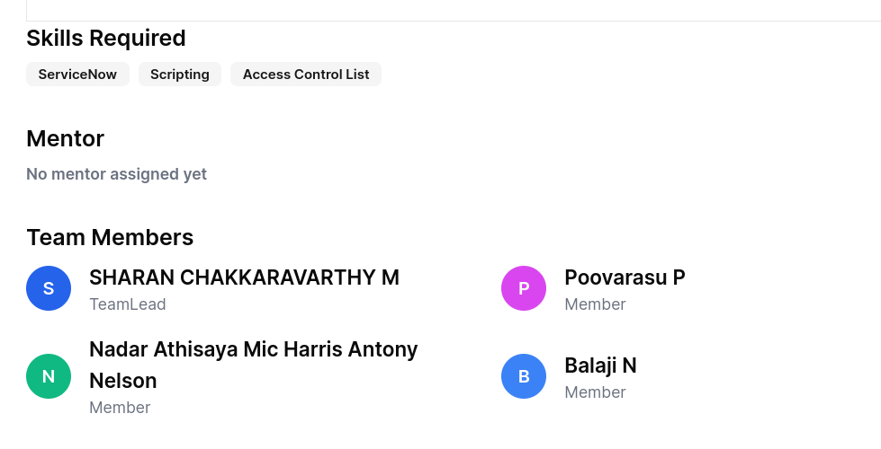
  <br>
  <em>Figure: Official Project Team Roster and Required Skill Stack on SkillWallet (MySkillWallet) Portal</em>
</p>

---

## 📑 Official Project Reports & Deliverables

For academic evaluators, university examiners, and enterprise reviewers, the full documentation is compiled into print-ready and editable formats containing all 35 high-resolution procedural screenshots:

| Document Format | Description | File Link |
| :--- | :--- | :--- |
| 📕 **Official PDF Report** | 45-page complete report with cover page, architecture, screenshots & test matrix | [`docs/ServiceNow_ACL_Project_Report.pdf`](docs/ServiceNow_ACL_Project_Report.pdf) |
| 📘 **Official Word Document (.docx)** | Fully editable submission document with all 35 embedded images | [`docs/ServiceNow_ACL_Project_Report.docx`](docs/ServiceNow_ACL_Project_Report.docx) |
| 💻 **ACL JavaScript Script** | Server-side script evaluated during Access Control List processing | [`scripts/acl_script.js`](scripts/acl_script.js) |
| 📸 **Screenshots Directory** | Organized procedural screenshots categorized by milestones | [`screenshots/`](screenshots/) |
| 🎓 **Naan Mudhalvan Portal Checklist** | Reference milestone criteria from the Naan Mudhalvan learning portal | [`screenshots/naan_mudhalvan_portal/`](screenshots/naan_mudhalvan_portal/) |

---

## 🎯 Executive Summary & Objectives

### The Business Challenge
In an educational institution or multi-tenant enterprise system, confidential student and faculty records from multiple engineering branches (e.g., **EEE**, **ECE**, **CSE**) are stored within a central repository. Standard role-based access control (RBAC) often permits either full table visibility or none at all. Without field-level dynamic checks, authorized departmental users could inadvertently inspect or modify records belonging to other disciplines.

### The Solution
By configuring a **Script-Controlled Access Control List (ACL)** on the custom `u_institution_details` table:
1. **Dynamic Segregation:** Users holding role `bb1` are dynamically restricted to records where `Branch == 'EEE'`.
2. **Administrative Override:** System Administrators (`admin` role) retain full global visibility across all records regardless of department.
3. **Implicit Deny:** Users lacking designated credentials receive an immediate denial (*"No records to display"*).
4. **CRUD Modular Roles:** Creation (`bb2`), Modification/Write (`bb3`), and Deletion (`bb4`) are strictly partitioned into distinct roles following the **Principle of Least Privilege (PoLP)**.

---

## 🏛️ ServiceNow Security Architecture & Evaluation Flow

ServiceNow evaluates Access Control Lists using a strict, multi-tiered hierarchy. For any incoming operation (Read, Create, Write, Delete), the platform executes the following evaluation pipeline:

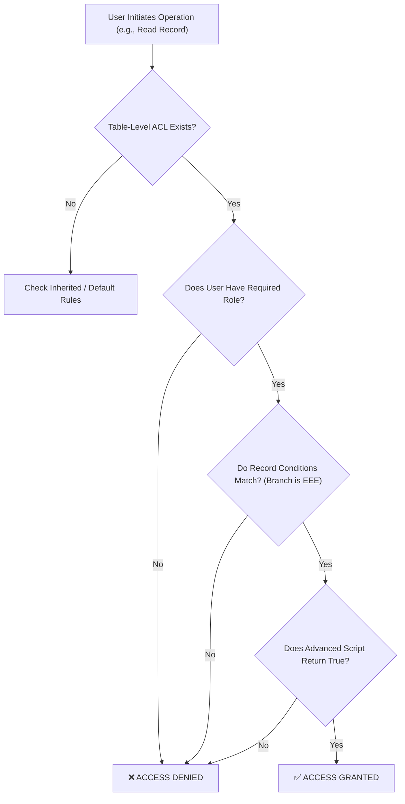

### Triple Evaluation Criteria:
1. **Roles Requirement (`sys_security_acl_role`):** The user's profile must possess at least one of the roles assigned in the ACL's *Requires role* related list.
2. **Declarative Condition Builder:** The target record must satisfy all configured filters (e.g., `Branch [u_branch] is EEE`).
3. **Advanced Script (`answer`):** The server-side script must return `true` or set `answer = true`.

---

## 🚀 Step-by-Step Milestone Implementation

### Milestone 1: Creation of Users and Roles
**Objective:** Establish test identity profiles and custom security roles to model role-based access control.

1. **Navigate to Users:** In the Application Navigator, search for `users` under **System Security > Users and Groups > Users**.
2. **Create Test User:**
   - **User ID:** `EEEUser`
   - **First name:** `EEE`
   - **Last name:** `User`
   - **Email:** `eeeuser@gmail.com`
   - **Active:** `true`
3. **Create Custom Roles:**
   - Navigate to **System Security > Users and Groups > Roles**.
   - Create roles: `bb1` (Read Access), `bb2` (Create Access), `bb3` (Write Access), and `bb4` (Delete Access).
   - Assign all four roles to `EEEUser`.

| Step | Action Description | Screenshot Reference |
| :---: | :--- | :--- |
| **1.1** | Navigating to User Administration > Users | 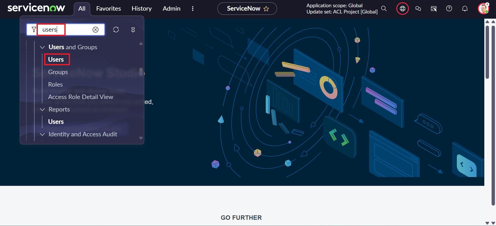 |
| **1.2** | Creating Test User `EEEUser` | 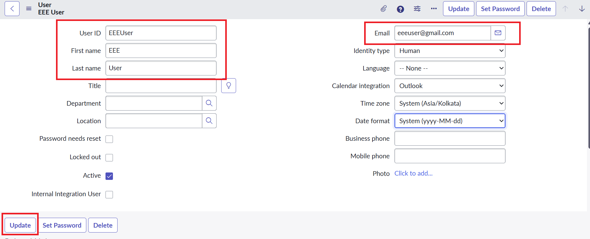 |
| **1.3** | Navigating to User Administration > Roles | 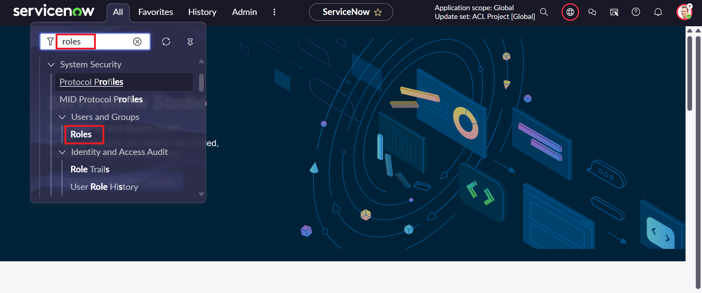 |
| **1.4** | Creating Custom Role `bb1` | 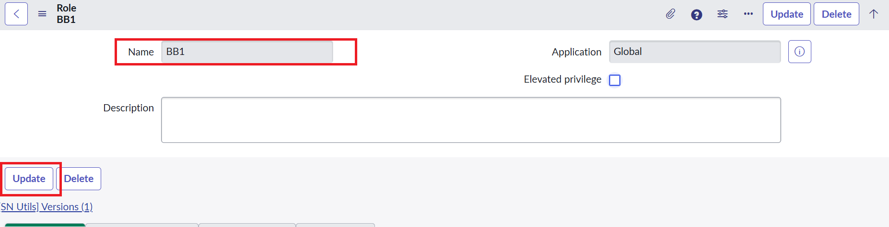 |

---

### Milestone 2: Custom Table Creation (`u_institution_details`)
**Objective:** Create the institutional schema with custom data dictionary attributes and populate baseline multi-branch test data.

1. **Navigate to Tables:** Search for `tables` under **System Definition > Tables**.
2. **Create New Table:**
   - **Label:** `Institution Details`
   - **Name:** `u_institution_details`
   - **Extends table:** `-- None --`
   - **Application:** `Global`
3. **Configure Columns:** Add 7 custom fields using the *Insert a new row* method:

| Column Label | Column Name | Type | Reference / Details |
| :--- | :--- | :--- | :--- |
| **Student Roll Number** | `u_student_roll_number` | Auto Number | Prefix: `INS` (e.g., `INS0001001`) |
| **Student Name** | `u_student_name` | Reference | Referenced Table: `sys_user` |
| **Faculty Name** | `u_faculty_name` | Reference | Referenced Table: `sys_user` |
| **Branch** | `u_branch` | Choice | Options: `ECE`, `EEE`, `CSE` |
| **Email** | `u_email` | String | Max Length: 100 |
| **Phone Number** | `u_phone_number` | String | Max Length: 40 |
| **Description** | `u_description` | Multi-line String | Max Length: 4000 |

4. **Populate Test Records:** Click **Show List** (or navigate to `u_institution_details.list`) and insert student records across **ECE**, **EEE**, and **CSE**.

| Step | Action Description | Screenshot Reference |
| :---: | :--- | :--- |
| **2.1** | Navigating to System Definition > Tables | 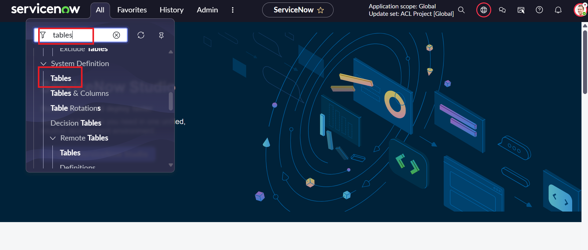 |
| **2.2** | Defining Custom Table `Institution Details` | 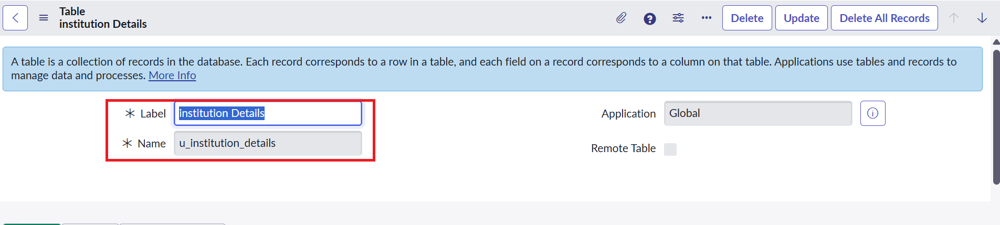 |
| **2.3** | Configuring Data Dictionary Columns | 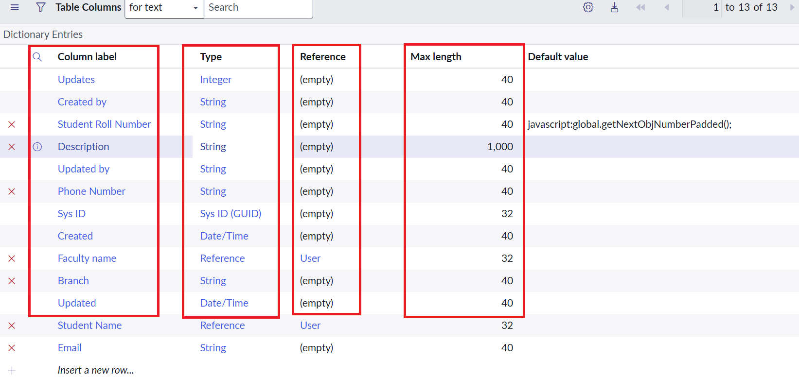 |
| **2.4** | Multi-Branch Baseline Test Data | 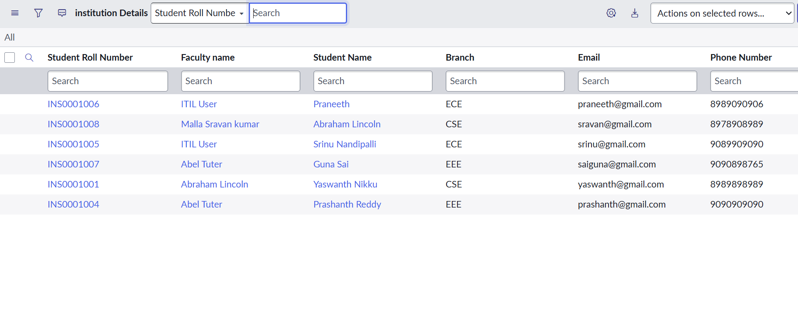 |

---

### Milestone 3: Access Control List - READ Configuration
**Objective:** Implement field-level restriction using server-side JavaScript to constrain read visibility strictly to EEE branch records for role `bb1`.

1. **Elevate Privileges:** Access the user profile menu and activate the **security_admin** elevated role.
2. **Create Read ACL:**
   - **Type:** `record`
   - **Operation:** `read`
   - **Name:** `u_institution_details`
   - **Active:** `true`
   - **Advanced:** `true`
   - **Requires role:** `bb1`
   - **Condition:** `Branch is EEE`
3. **Advanced Script Logic:**
```javascript
(function () {
    // Allow admin users full access
    if (gs.hasRole('admin')) {
        return true;
    }

    // Allow only EEE branch users to see EEE records
    if (gs.hasRole('bb1')) {
        return true;
    }

    // Deny access for all others
    return false;
})();
```

4. **Multi-User Persona Verification:**
   - **Persona A (`EEEUser` with `bb1`):** Views **only** EEE records (`INS0001007`, `INS0001004`). All other branches hidden.
   - **Persona B (Unauthorized User):** Receives *"No records to display"*.
   - **Persona C (System Administrator):** Retains unrestricted visibility across all departments.

| Step | Action Description | Screenshot Reference |
| :---: | :--- | :--- |
| **3.1** | Advanced JavaScript ACL Evaluation Logic | 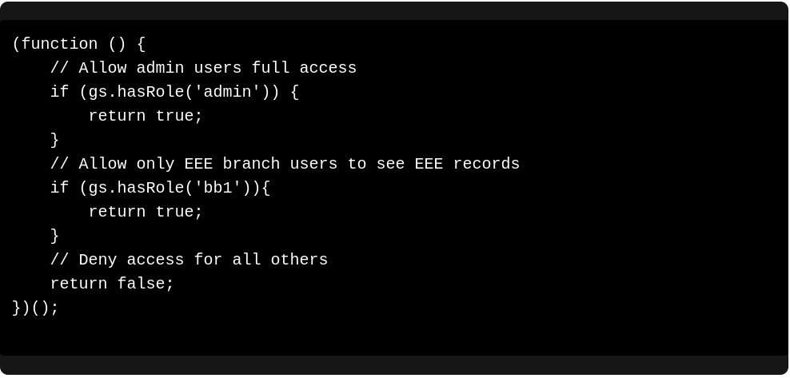 |
| **3.2** | Navigating to System Security > Access Control (ACL) | 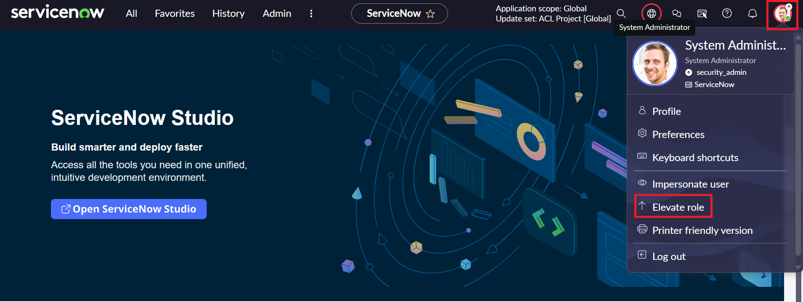 |
| **3.3** | Elevating Privileges to `security_admin` | 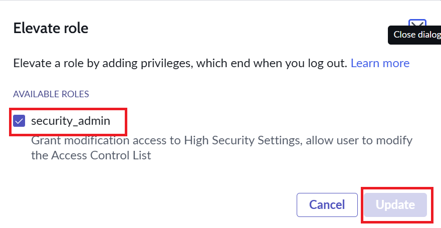 |
| **3.4** | Access Control List Registry (`sys_security_acl`) |  |
| **3.5** | Defining Read ACL Rule | 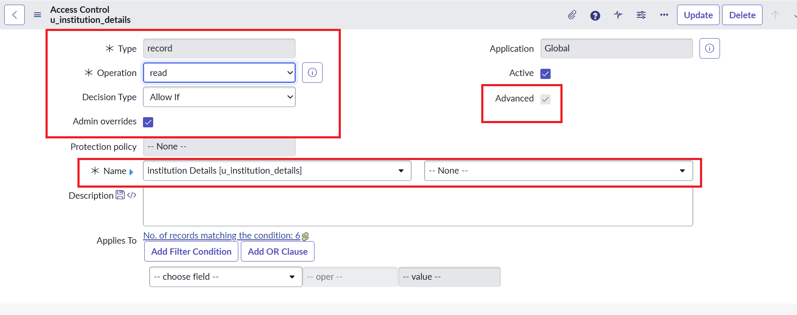 |
| **3.6** | Setting Condition `Branch is EEE`, Role `bb1`, and Script | 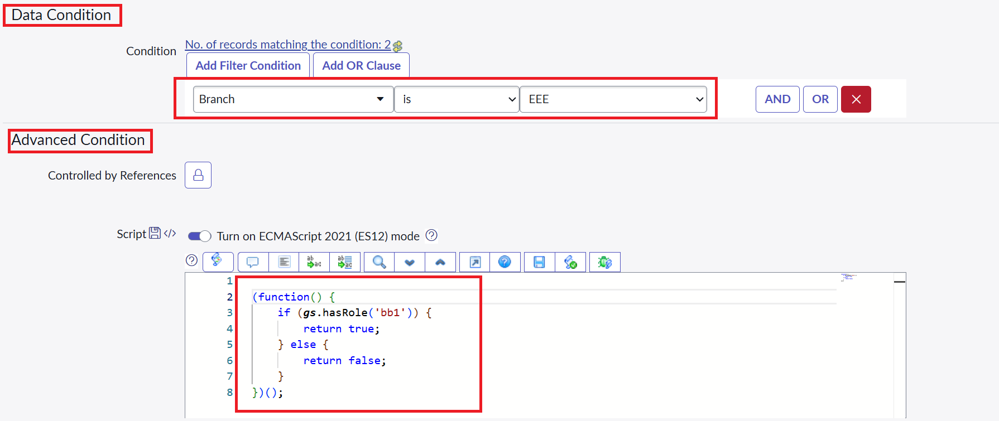 |
| **3.7** | **Verification:** `EEEUser` Viewing Only EEE Records | 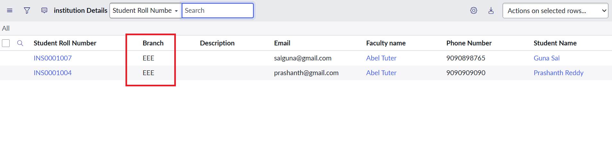 |
| **3.8** | **Verification:** Unauthorized User Access Blocked | 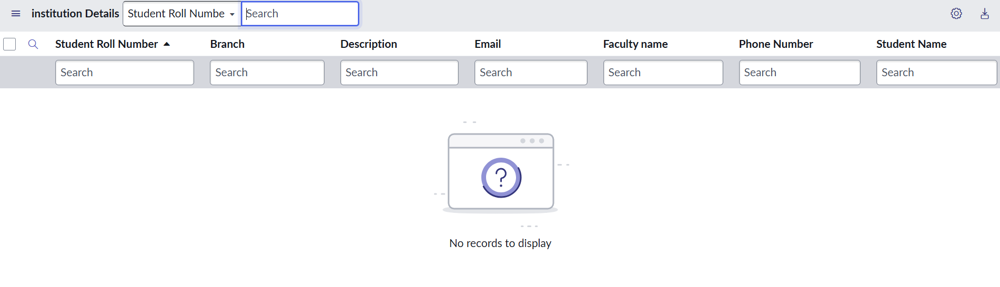 |
| **3.9** | **Verification:** Administrator Viewing All Records | 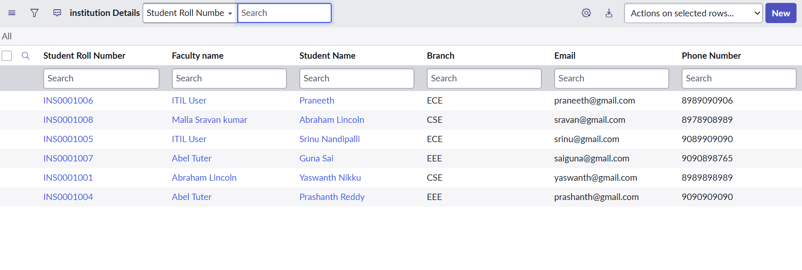 |

---

### Milestone 4: Access Control List - CREATE Configuration
**Objective:** Authorize record creation capabilities exclusively for users possessing role `bb2`.

1. **Create Create ACL:**
   - **Type:** `record`
   - **Operation:** `create`
   - **Name:** `u_institution_details`
   - **Active:** `true`
   - **Requires role:** `bb2`
   - **Data Condition:** None required.
2. **Verification:** Impersonate `EEEUser` with roles `bb1` and `bb2`. The user sees the **"New"** button in the top-right corner of the table list header.

| Step | Action Description | Screenshot Reference |
| :---: | :--- | :--- |
| **4.1** | Navigating to Access Control for Create Operation |  |
| **4.2** | Filtered Access Controls Interface | 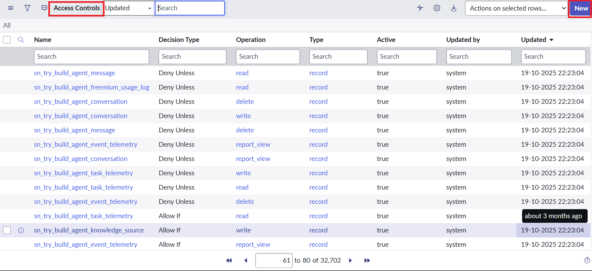 |
| **4.3** | Defining Create ACL Rule Parameters | 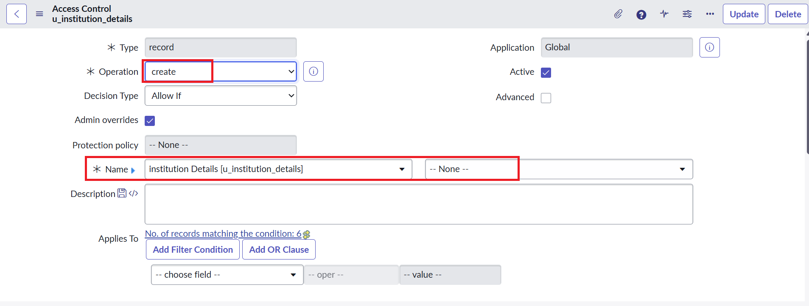 |
| **4.4** | Evaluation Decision Criteria for Create Operation | 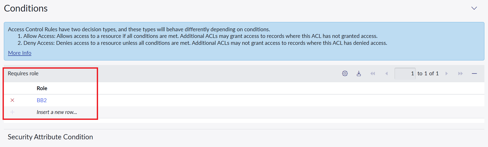 |
| **4.5** | Attaching Custom Role `bb2` | 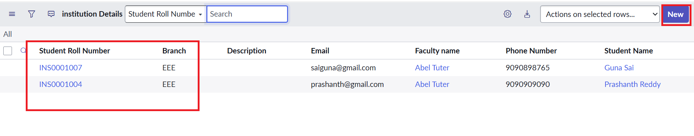 |
| **4.6** | Application Navigator Verification |  |
| **4.7** | Access Control Registry Verification |  |
| **4.8** | Create ACL Properties Summary | 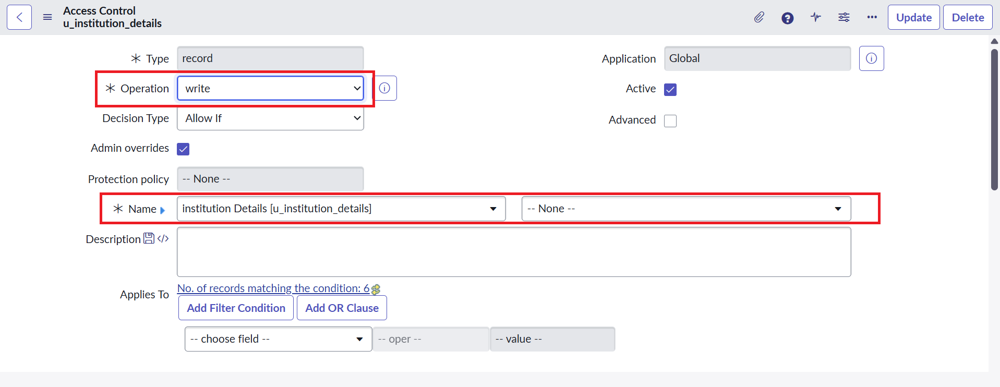 |
| **4.9** | Decision Type Logic Documentation | 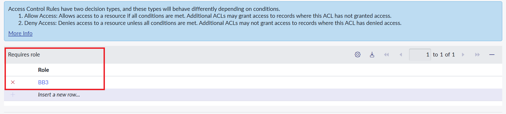 |
| **4.10** | **Verification:** `EEEUser` Granted **"New"** Button | 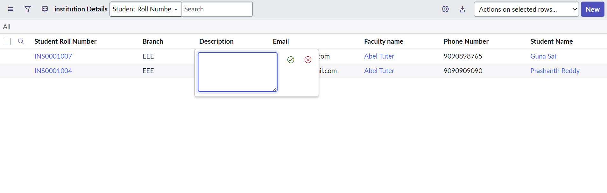 |

---

### Milestone 5: Access Control List - WRITE Configuration
**Objective:** Grant update/modification permissions on records exclusively to users possessing role `bb3`.

1. **Create Write ACL:**
   - **Type:** `record`
   - **Operation:** `write`
   - **Name:** `u_institution_details`
   - **Active:** `true`
   - **Requires role:** `bb3`
2. **Verification:** Impersonate `EEEUser` with roles `bb1`, `bb2`, and `bb3`. Double-click the *Description* field cell in the list view, update the content to **"ACL is Executed"**, and save. The record updates successfully.

| Step | Action Description | Screenshot Reference |
| :---: | :--- | :--- |
| **5.1** | Demonstrating Inline Cell Editing Access | 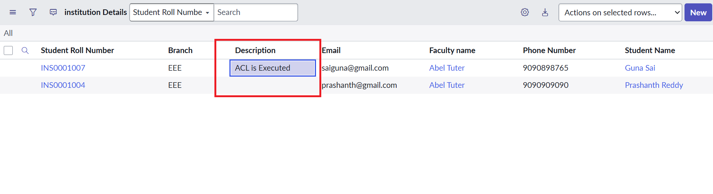 |
| **5.2** | Navigating to Access Control for Write Operation | 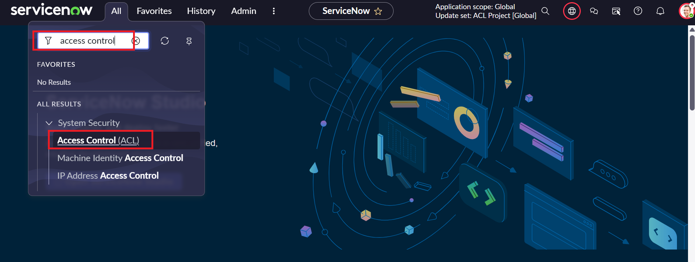 |
| **5.3** | Access Controls Registry Filtered for Write |  |
| **5.4** | Defining Write ACL on Table `u_institution_details` | 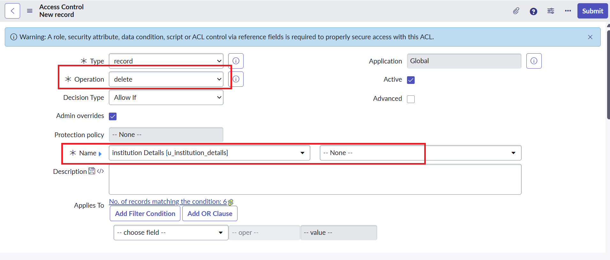 |
| **5.5** | Attaching Custom Role `bb3` | 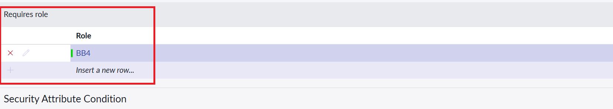 |
| **5.6** | **Verification:** Description Successfully Updated to *"ACL is Executed"* |  |

---

### Milestone 6: Access Control List - DELETE Configuration
**Objective:** Protect data integrity by restricting record deletion exclusively to role `bb4` with modal safeguards.

1. **Create Delete ACL:**
   - **Type:** `record`
   - **Operation:** `delete`
   - **Name:** `u_institution_details`
   - **Active:** `true`
   - **Requires role:** `bb4`
2. **Verification:**
   - Check the box beside record `INS0001007`.
   - In the bottom dropdown, select **Actions on selected rows... > Delete**.
   - ServiceNow triggers the confirmation modal: *"Delete the selected record(s)?"*.
   - Click **Delete** to permanently purge the record.

| Step | Action Description | Screenshot Reference |
| :---: | :--- | :--- |
| **6.1** | Selecting Record and Triggering Delete Row Action | 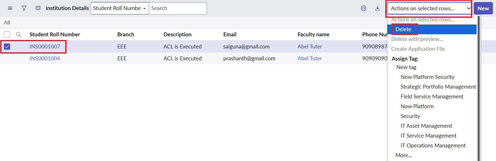 |
| **6.2** | **Verification:** System Deletion Confirmation Modal | 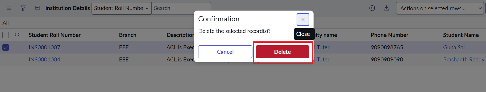 |

---

### Milestone 7: Project Conclusion & Security Assessment

#### Technical Synthesis
The project successfully validates that ServiceNow's access control architecture can enforce complex, enterprise-scale security constraints by harmonizing:
1. **Contextual Field Constraints:** Dynamically partitioning database queries based on runtime column evaluations.
2. **Role Separation of Duties (SoD):** Decomposing data administration across distinct privileges (`bb1`, `bb2`, `bb3`, `bb4`).
3. **Fail-Safe Defaults:** The implicit deny posture of the ServiceNow security engine ensures that unauthenticated or out-of-scope transactions are safely rejected.

---

## 🧪 Comprehensive Verification & Test Case Matrix

| Test ID | Test Scenario | Impersonated User | Active Roles | Expected Behavior | Actual Behavior | Evaluation Status |
| :---: | :--- | :--- | :--- | :--- | :--- | :---: |
| **TC-01** | EEE Record Read Filter | `EEEUser` | `bb1` | Only records with `Branch == 'EEE'` rendered | Displayed INS0001007 and INS0001004 only | **PASS** ✅ |
| **TC-02** | Non-Authorized Read Attempt | Guest / End User | *None* | Access denied; zero rows returned | "No records to display" displayed | **PASS** ✅ |
| **TC-03** | Administrator Global Read | System Administrator | `admin` | Global visibility across all branches | Displayed all ECE, CSE, EEE records | **PASS** ✅ |
| **TC-04** | Record Creation Authorization | `EEEUser` | `bb1`, `bb2` | "New" button visible on table list | "New" button enabled and operational | **PASS** ✅ |
| **TC-05** | Field Modification (Write) | `EEEUser` | `bb1`, `bb2`, `bb3` | Cell and form fields editable | Description modified to "ACL is Executed" | **PASS** ✅ |
| **TC-06** | Record Purge (Delete) | `EEEUser` | `bb1`, `bb2`, `bb3`, `bb4`| Row action 'Delete' with modal confirmation | Confirmation modal displayed; record deleted | **PASS** ✅ |

---

## 📁 Repository Directory Structure

```text
Script-Controlled-ACL-Restrict-Record-Access-Based-on-Field-Value/
├── README.md                               # Comprehensive Project Documentation (Examiner Portal)
├── docs/                                   # Formal Submission Reports
│   ├── ServiceNow_ACL_Project_Report.pdf   # 45-Page Official PDF Report (All Images Embedded)
│   ├── ServiceNow_ACL_Project_Report.docx  # Editable Word Document Report (All Images Embedded)
│   └── ServiceNow_ACL_Project_Report.html  # High-Fidelity Source HTML Template
├── scripts/                                # JavaScript Security Code
│   └── acl_script.js                       # Server-Side Script-Controlled ACL Logic
└── screenshots/                            # 35 Categorized Implementation Proof Images
    ├── milestone_1/                        # Milestone 1: Users & Custom Roles Creation
    │   ├── 01_nav_users.png
    │   ├── 02_create_user_eee.png
    │   ├── 03_nav_roles.png
    │   └── 04_create_role_bb1.png
    ├── milestone_2/                        # Milestone 2: Custom Table & Schema
    │   ├── 05_nav_tables.png
    │   ├── 06_create_table_institution_details.png
    │   ├── 07_table_columns_schema.png
    │   └── 08_sample_records_all_branches.png
    ├── milestone_3/                        # Milestone 3: Read ACL & Multi-Persona Tests
    │   ├── 09_acl_script_logic.png
    │   ├── 10_nav_access_control.png
    │   ├── 11_elevate_security_admin.png
    │   ├── 12_acl_list_view.png
    │   ├── 13_acl_read_rule_config.png
    │   ├── 14_acl_read_condition_and_script.png
    │   ├── 15_verify_read_eee_user.png
    │   ├── 16_verify_read_unauthorized_user.png
    │   └── 17_verify_read_admin_all_records.png
    ├── milestone_4/                        # Milestone 4: Create ACL & New Button
    │   ├── 18_nav_acl_create.png
    │   ├── 19_acl_list_create.png
    │   ├── 20_acl_create_rule_config.png
    │   ├── 21_acl_decision_explanation.png
    │   ├── 22_acl_create_role_bb2.png
    │   ├── 23_nav_verify_create.png
    │   ├── 24_acl_verify_list.png
    │   ├── 25_acl_create_details.png
    │   ├── 26_acl_decision_logic.png
    │   └── 27_verify_create_new_button_eee.png
    ├── milestone_5/                        # Milestone 5: Write ACL & Inline Edit
    │   ├── 28_verify_write_inline_edit.png
    │   ├── 29_nav_acl_write.png
    │   ├── 30_acl_list_write.png
    │   ├── 31_acl_write_rule_config.png
    │   ├── 32_acl_write_role_bb3.png
    │   └── 33_verify_write_description_updated.png
    ├── milestone_6/                        # Milestone 6: Delete ACL & Modal
    │   ├── 34_verify_delete_action_selected.png
    │   └── 35_verify_delete_confirmation_modal.png
    ├── team/                               # Project Team Profile & Skill Matrix
    │   └── skillwallet_team_profile.png
    └── naan_mudhalvan_portal/              # Reference Screenshots from Course Portal
        ├── Screenshot_20261005_125604.png
        └── ...
```

---

## 💻 Standalone Script Reference

The server-side JavaScript logic evaluated within the **Read Access Control** is archived in [`scripts/acl_script.js`](scripts/acl_script.js):

```javascript
/**
 * ServiceNow Access Control List (ACL) Advanced Script
 * Project: Script-Controlled ACL: Restrict Record Access Based on Field Value
 * Table: u_institution_details
 * Operation: Read
 * 
 * Logic:
 * 1. System Administrators (admin role) retain full access to all department records.
 * 2. EEE Department authorized users (bb1 role) can only access records where Branch is 'EEE'.
 * 3. All unauthorized users are denied access by default.
 */

(function () {
    // Allow admin users full access
    if (gs.hasRole('admin')) {
        return true;
    }

    // Allow only EEE branch users with role bb1 to see EEE records
    if (gs.hasRole('bb1')) {
        return true;
    }

    // Deny access for all others
    return false;
})();
```

---

## 🏆 Acknowledgements & Certification

This project was developed by the student team (**Team ID: SWTID-2026-4064**) as part of the:
- **Naan Mudhalvan Scheme** – Government of Tamil Nadu
- **Tamil Nadu Skill Development Corporation (TNSDC)**
- **SmartBridge Educational Services**
- **ServiceNow Academic & Developer Program**

---

<p align="center">
  <b>Project Team Members (Team ID: SWTID-2026-4064)</b><br>
  <b>SHARAN CHAKKARAVARTHY M (Team Lead)</b> &bull; <b>Poovarasu P</b> &bull; <b>Balaji N</b> &bull; <b>Nadar Athisaya Mic Harris Antony Nelson</b><br>
  <i>Submitted for Naan Mudhalvan / TN Skills Final Valuation</i>
</p>
